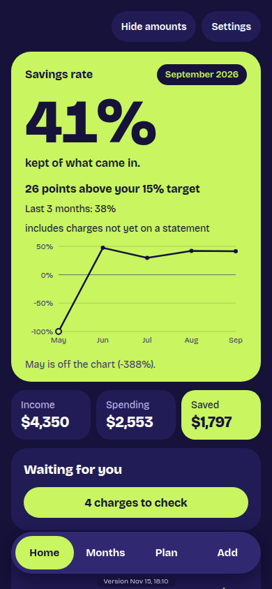
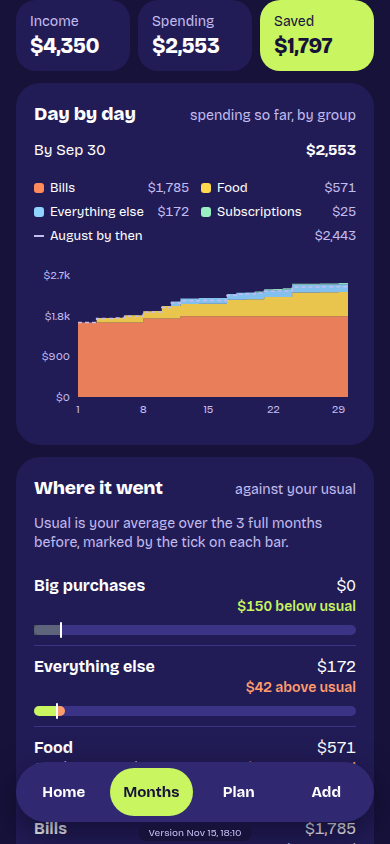
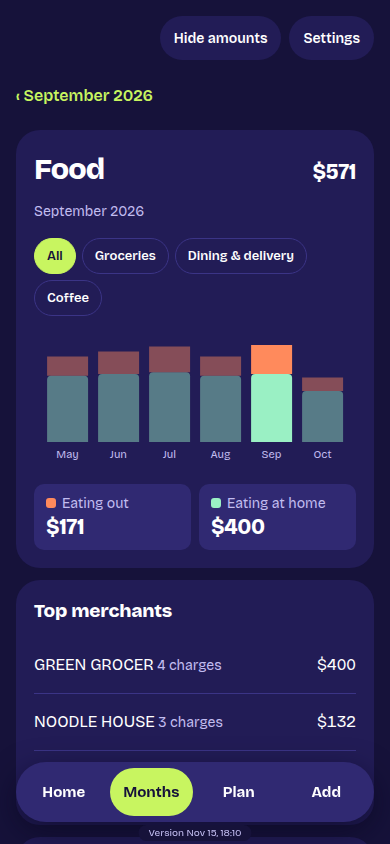
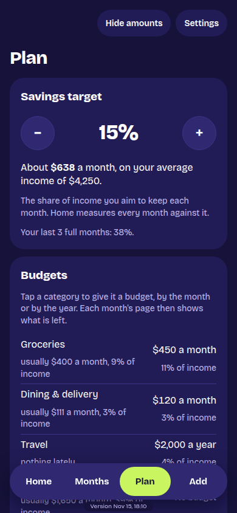
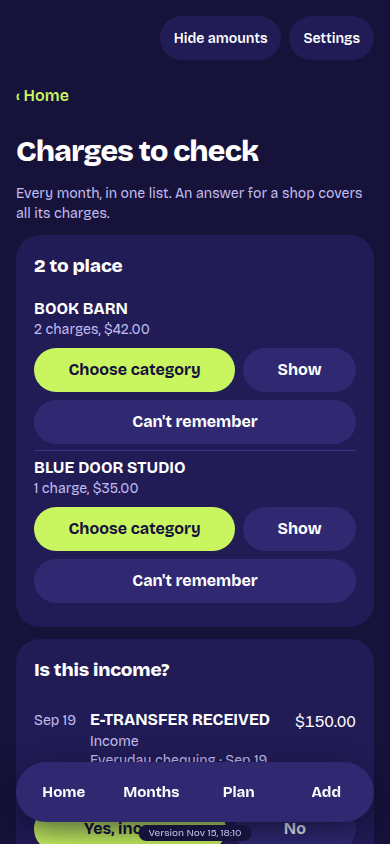

# Budget

A self-hosted budgeting app you run yourself and use from your phone. You upload the statement
files your bank already gives you; it works out your savings rate each month and shows where the
money went. Nothing is sent to a third party and there is no bank login.

| Home | A month, day by day | One group | Plan | Charges to check |
|---|---|---|---|---|
|  |  |  |  |  |

**[Live demo](https://apps.graemecrawley.com/demos/budget/)**: the whole app in your browser, running on
invented data. The screenshots show the same sample data, not anyone's accounts.

## What it does

- **Savings rate first.** Home leads with the last full month's rate against a target you set.
- **Statements in, not bank logins.** Add one export per account each month. A file is accepted
  only if it checks out (a statement must balance), and the app knows which months each account
  covers, so a month is marked incomplete until every account has it.
- **Categories you correct once.** Rules place most charges; an answer for a shop covers all its
  charges, past and future.
- **Where it went.** Each month against your usual, spending built up day by day, the biggest
  charges, and any one category across the months.
- **Budgets.** A budget for any category, by the month or by the year, with what is left.
- **Reminders.** The app's own phone notifications on the 1st, naming the accounts still missing.
  See [docs/phone-notifications.md](docs/phone-notifications.md) for what was tested on an iPhone.

## Currently supported connectors

A connector reads one kind of file from one institution. The app picks the connector from the
file itself.

| Institution | Account | File you download | Connector |
|---|---|---|---|
| CIBC | Chequing | Monthly statement (PDF) | `connectors/cibc_chequing.py` |
| American Express | Credit card | Monthly statement (PDF) | `connectors/amex.py` |
| Wealthsimple | Cash account | Monthly statement (CSV) | `connectors/wealthsimple_cash.py` |
| Wealthsimple | Chequing | Monthly statement (PDF) | `connectors/wealthsimple_bills.py` |
| Wealthsimple | Credit card | Statement transactions (CSV) | `connectors/wealthsimple_card.py` |
| Any other bank | Any | "Download transactions" CSV with a header row | `connectors/generic_csv.py` |

The generic CSV connector takes activity without balances, so it cannot check that a month is
whole the way a statement connector can. To add an institution, copy the closest connector, add
invented fixtures under `tests/fixtures/connectors/`, and register it in `connectors/registry.py`.
`connectors/contract.py` lists the checks every batch must pass.

## Run it

You need Docker.

```
mkdir data
cp access.example.json data/access.json
docker compose up -d --build
docker compose exec budget python -m tracker.cli check   # once: creates the empty ledger
```

Then open http://localhost:8000/ and go to Add. Until the ledger exists the app answers 503.

**The app has no login of its own.** It was built to sit behind Cloudflare Access, and it checks
the login token Cloudflare adds to each request. `data/access.json` controls that check:

- `"mode": "report"` lets every request in as the owner. Use it only where nobody else can reach
  the port, which is why the example compose file listens on 127.0.0.1 only.
- `"mode": "enforce"` refuses any request without a valid Cloudflare Access token for an address
  listed under `users`. Set `team_domain` and `aud` from your Access application.

Without `data/access.json` the app answers 503 to everything: it fails closed.

Your ledger is `data/tracker.db`. `scripts/backup-ledger.py` makes a dated, checked copy and keeps
the newest 30; run it nightly from cron.

For the monthly reminder, turn reminders on in Settings from the phone, then run this from cron
at the times you want to be reminded (it sends nothing once every account has last month):

```
docker exec budget python -m tracker.cli remind
```

Phone notifications need the app served over https at a real address, set in `GB_SITE_URL`.

## Develop

```
pip install -r requirements.txt -r requirements-dev.txt
pytest

cd web
npm ci
npx vitest run
VITE_MOCK=1 npx vite        # the whole app on sample data, no server needed
```

The server is Python (FastAPI, SQLite) in `tracker/`; the phone client is React in `web/`.
Statement PDFs are read with `pdftotext` (the `poppler-utils` package).

## Privacy rules the code follows

- Money is stored as integer cents in one SQLite file that never leaves your machine.
- Nothing logs or prints an amount, a description or a file's contents; tools print counts and
  statuses only.
- Notification text never carries a dollar figure.
- Every fixture in `tests/` is invented.

## Licence

MIT. See [LICENSE](LICENSE).
